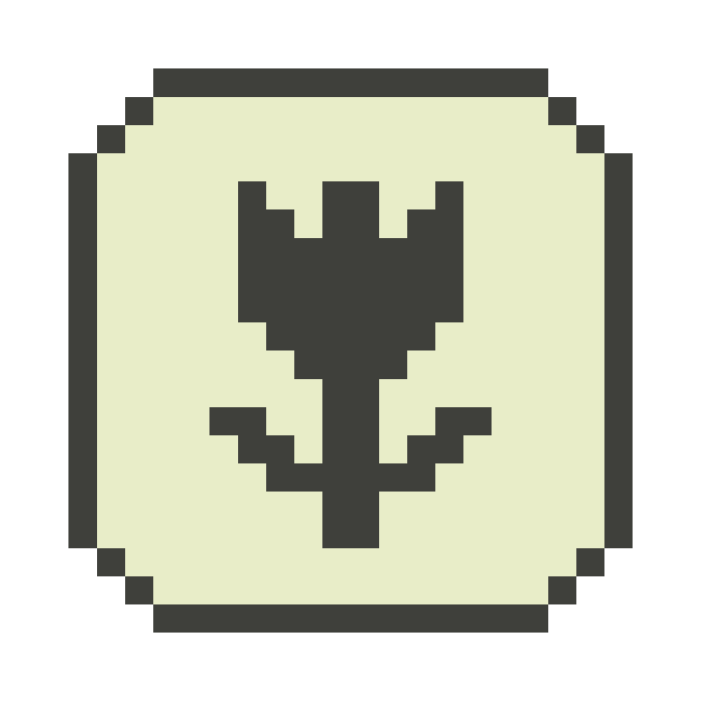
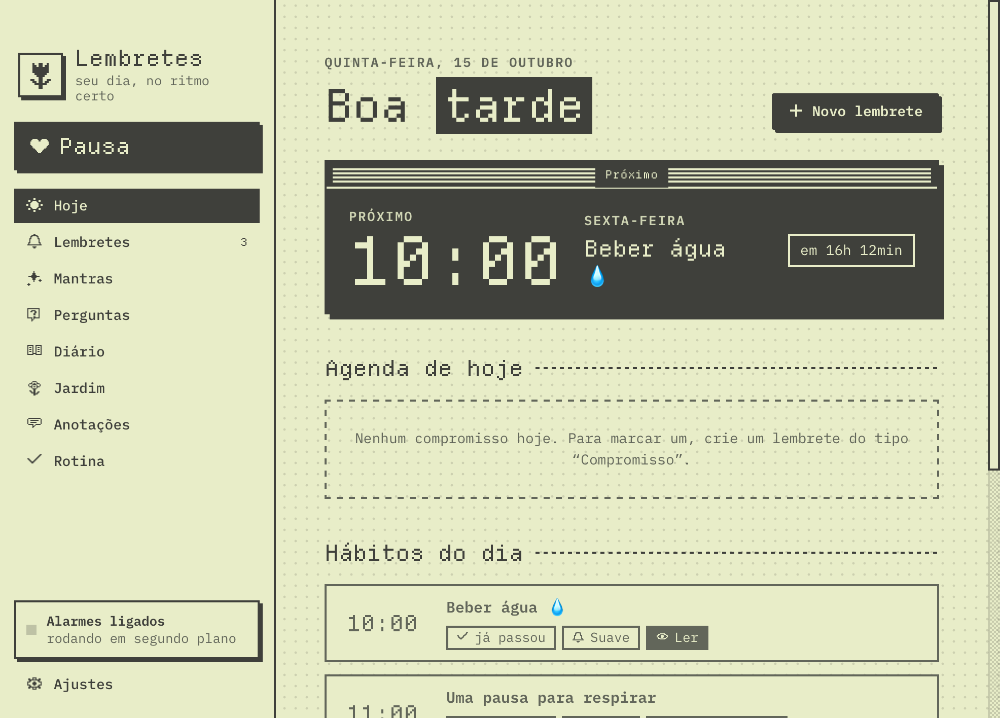
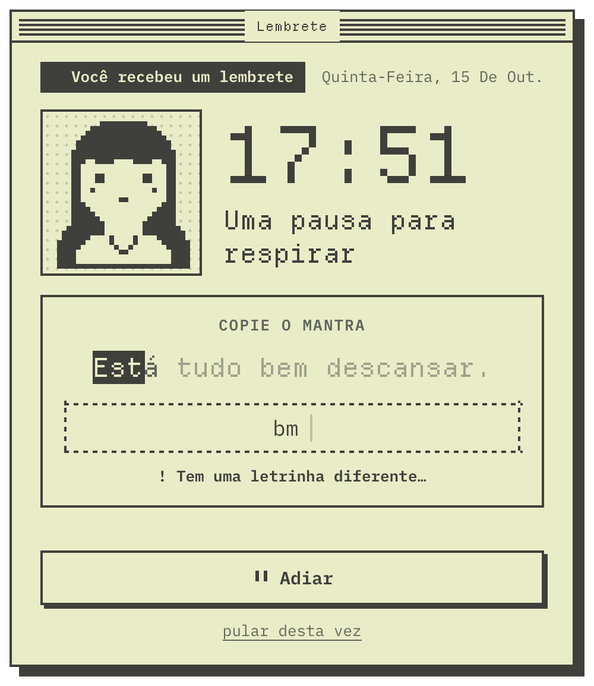
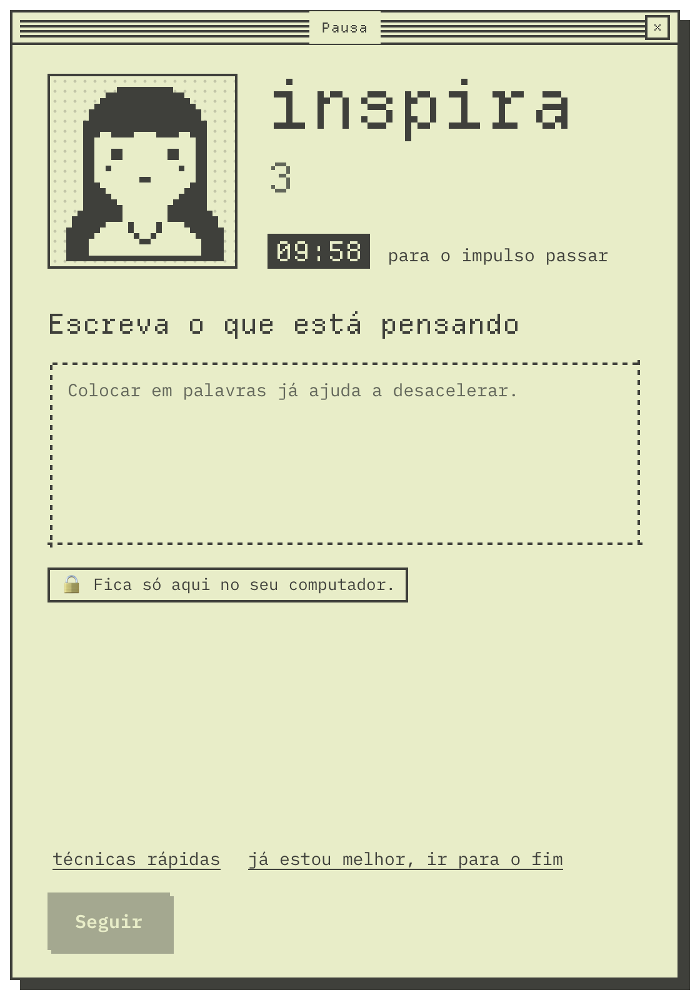
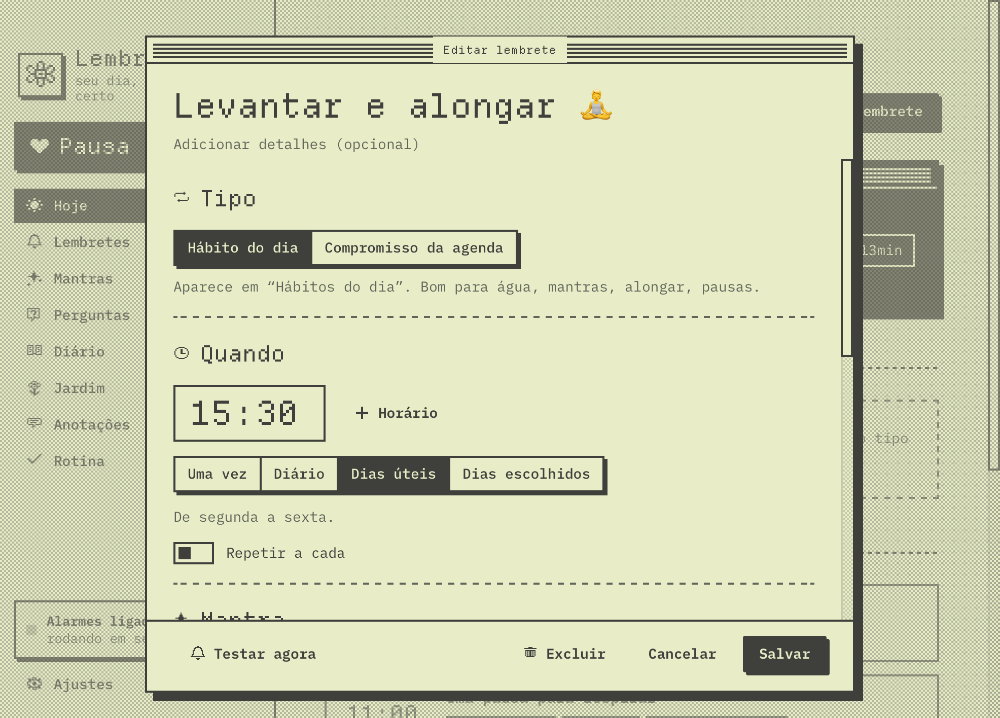
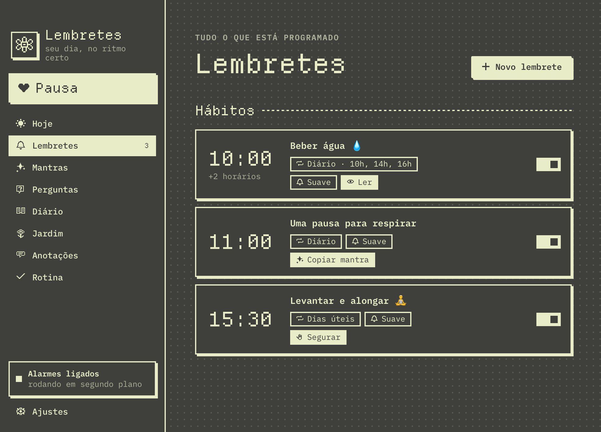

<p align="center"></p>

# Lembretes

Um app de lembretes e bem-estar para Mac, com cara de computador antigo e carinhoso: duas cores, letras pixeladas e uma personagem que respira junto com você. Os lembretes viram pequenas pausas no dia (beber água, alongar, respirar, ler uma frase). O app também tem um botão de **Pausa** para respirar antes de agir no impulso.

Tudo fica no seu computador. Não tem conta, internet, nem analytics.

<p align="center">
  
  
</p>

## O que o app faz

- **Lembretes com vários horários** ("Beber água · 10h, 14h, 16h"). Podem tocar uma vez, todo dia, em dias úteis, em dias escolhidos ou "a cada N horas". Cada lembrete é um **hábito do dia** ou um **compromisso da agenda**.
- **Pop-up que só fecha com uma tarefinha:** ler, resolver contas, copiar uma frase (as letras acendem conforme você digita), responder uma pergunta ou segurar um botão. O som (suave, música ou silencioso) para assim que a tarefa termina. Também dá para adiar 5, 10 ou 30 min, ou "pular desta vez", sem culpa.
- **Pausa** (botão na lateral ou **⌥⌘V** de qualquer lugar do Mac): um momento para respirar antes de agir por impulso.
  - você dá uma nota para o impulso e recebe uma frase;
  - respira guiado no ritmo 4-7, com timer, e a personagem respira junto;
  - escreve o que está pensando (fica só no seu computador);
  - no fim, dá uma nota de novo e anota no diário o que decidiu.
  Opcionalmente, ela abre sozinha quando um app ou site da sua lista vier para a frente.
- **Modo não perturbe** por 30 min, 1 h, 2 h, até desligar ou até amanhã, pela lateral ou pela barra de menus. Também pode ligar sozinho quando um app da sua lista estiver na frente, como um jogo ou uma chamada de vídeo. Os lembretes esperam numa fila e aparecem quando o modo acaba.
- **Visitantes pixelados:** de vez em quando um gatinho passeia pela base da janela. Clique nele para ganhar um gestinho ou uma frase. Ele nunca aparece com o editor ou um pop-up aberto, nem enquanto você digita.
- **Diário** com as respostas, as pausas e os pulos.
- **Backup automático** diário, fora da pasta do app.
- **Claro e escuro** automáticos (o escuro inverte as duas cores), com contraste AA.

<p align="center">
  
  
  
</p>

## Como instalar

Precisa de um **Mac** e do **Python 3** do [python.org](https://www.python.org/downloads/macos/).

```bash
git clone <endereço deste repositório> lembretes
cd lembretes
./instalar.sh
```

O instalador:
1. instala o [pywebview](https://pywebview.flowrl.com/);
2. gera os sons;
3. cria o **Lembretes.app** em Aplicativos;
4. liga o serviço que dispara os alarmes (ele inicia junto com o Mac).

Depois é só abrir o **Lembretes** pela pasta Aplicativos. Na primeira vez, o app cria a pasta `data/` com alguns exemplos.

Para remover, rode `./desinstalar.sh`. Seus dados continuam na pasta `data/`.

### Permissões
- **Nenhuma, no uso normal.** O atalho ⌥⌘V usa o registro de atalhos do próprio macOS, e o app não lê o que você digita.
- **Opcional:** em Ajustes → Pausa → "Olhar o endereço da aba ativa do navegador". Com isso ligado, o macOS pede uma vez para o Lembretes "controlar" o navegador. É só para ler o **endereço** da aba ativa e comparar com a sua lista de sites gatilho. Nada é guardado.

## Personalizar

- **Frases e perguntas:** vêm 5 exemplos de cada. Os dados ficam em `data/` como JSON.
- **Personagem:** troque os PNGs em `ui/sprites/` pelos seus desenhos. O `LEIA-ME.txt` de lá explica os tamanhos e as cores.
- **Visitantes:** cada um tem uma pasta em `ui/sprites/visitantes/` e uma entrada em `visitantes.json`, com quadros, tamanho, velocidade, trajeto e gestos. Dá para criar novos sem mexer no código.
- **Cores:** a paleta inteira está em três variáveis no topo de `ui/base.css`.
- **Pasta de dados:** para guardar os dados em outro lugar (o iCloud Drive, por exemplo), crie `onde_ficam_os_dados.json` com `{"pasta": "~/caminho/da/pasta"}`.

## Como é feito por dentro

- **Python + [pywebview](https://pywebview.flowrl.com/):** as telas são HTML/CSS/JS numa janela nativa (WebKit).
- **Serviço em segundo plano** (LaunchAgent), que agenda e abre os alarmes mesmo com a janela fechada.
- **Som** via `afplay`.

| Arquivo | Para quê |
|---|---|
| `gerenciador.py` | janela principal |
| `servico.py` | agenda e dispara os alarmes, fila do não perturbe, backup |
| `vigia.py` | atalho global, apps e sites gatilho, ícone na barra de menus |
| `alarme.py`, `pausa.py`, `perdidos.py` | pop-ups |
| `comum.py` | dados, regras de horário, sons |
| `ui/` | telas, estilos, ícones, fontes e sprites |

## Como foi feito

Comecei este app querendo uma coisa simples: um pop-up que me lembrasse de beber água e tocasse uma musiquinha. Ele foi crescendo com o uso, um pedido de cada vez, até virar o que está aqui.

Fiz tudo conversando com o **[Claude Code](https://claude.com/claude-code)**, o assistente de programação da Anthropic, direto no terminal do meu Mac. Eu descrevia o que queria em português, do jeito que eu falaria com alguém; ele escrevia o código, testava e me mostrava o resultado. Quando algo não ficava como eu imaginava, eu dizia o que não tinha gostado e a gente ajustava.

Algumas coisas que guiaram o caminho:

- **Uma especificação viva.** Depois das primeiras versões, escrevi um documento com tudo o que eu queria (o propósito, as telas, as regras de privacidade e o visual) e dividi o trabalho em fases. A cada fase, o Claude parava e me mostrava o que tinha feito antes de seguir.
- **Calmo, nunca punitivo.** Sempre dá para pular, adiar ou fechar. Nada de sequência que "quebra" nem mensagem de cobrança.
- **Privacidade primeiro.** Tudo fica no computador, sem conta e sem internet. O app só sabe *qual* app está na frente, nunca o que tem dentro dele.
- **Testar de verdade.** Cada mudança foi conferida com capturas das telas, nos modos claro e escuro, e com testes das regras de horário. Bugs como "o pop-up abre atrás das outras janelas" ou "a janela fica com um espaço vazio" só apareceram assim, e foram corrigidos.
- **Um visual com personalidade.** A aparência em pixel nasceu de referências de sistemas antigos, de jardins em pixel art e de retratos de duas cores. A personagem, o gatinho e o ícone são desenhos provisórios que eu pretendo substituir pelos meus.

O resultado é um app feito sob medida, no ritmo de uma conversa. Se você quiser adaptar para você, é só abrir a pasta e mudar o que fizer sentido.

Feito por [@laurabrafman](https://github.com/laurabrafman).

## Créditos

- Fontes: [Departure Mono](https://departuremono.com/) (Helena Zhang) e [IBM Plex Mono](https://github.com/IBM/plex), ambas sob a SIL Open Font License. As licenças estão em `ui/fonts/`.
